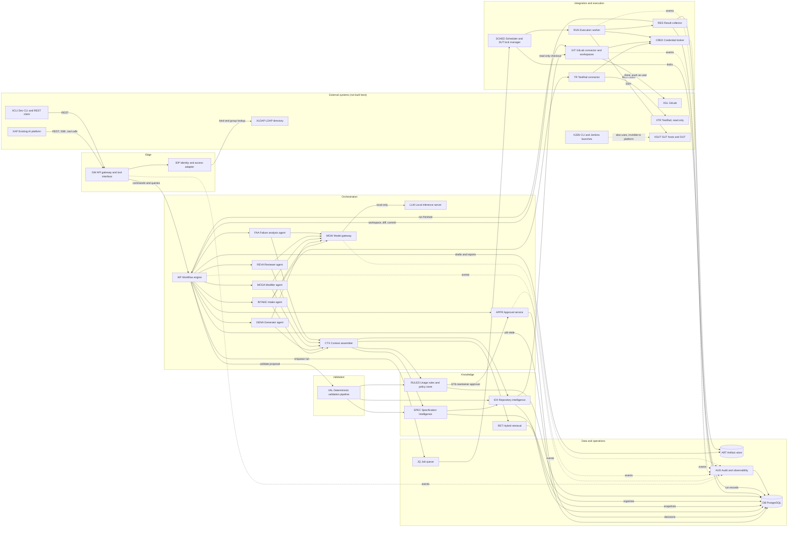
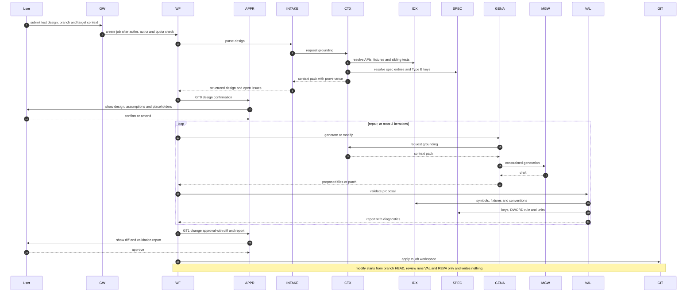
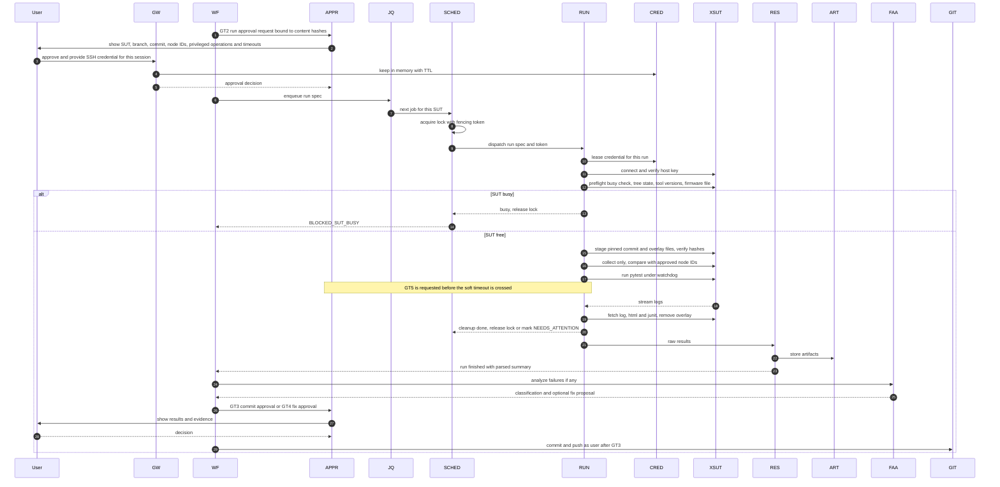
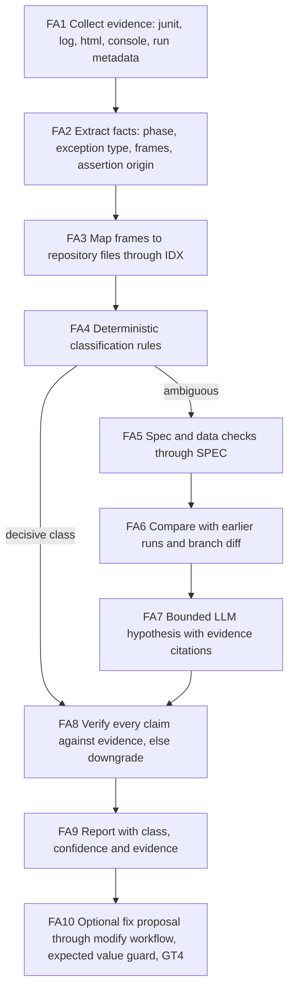
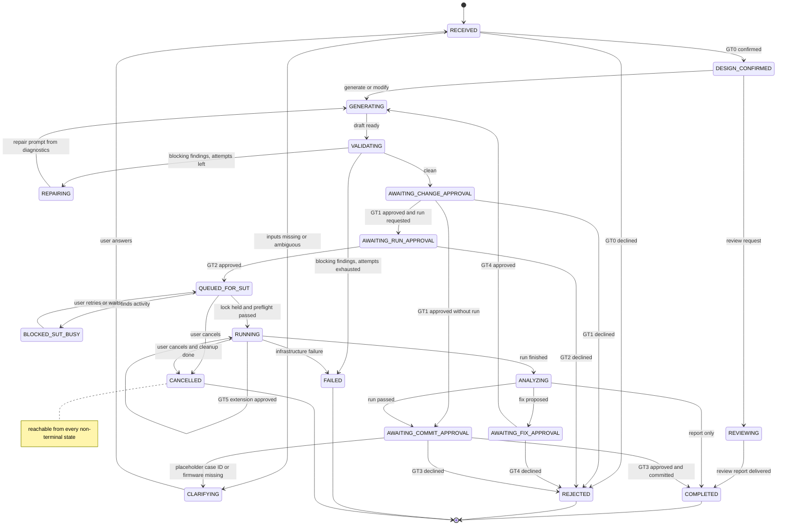
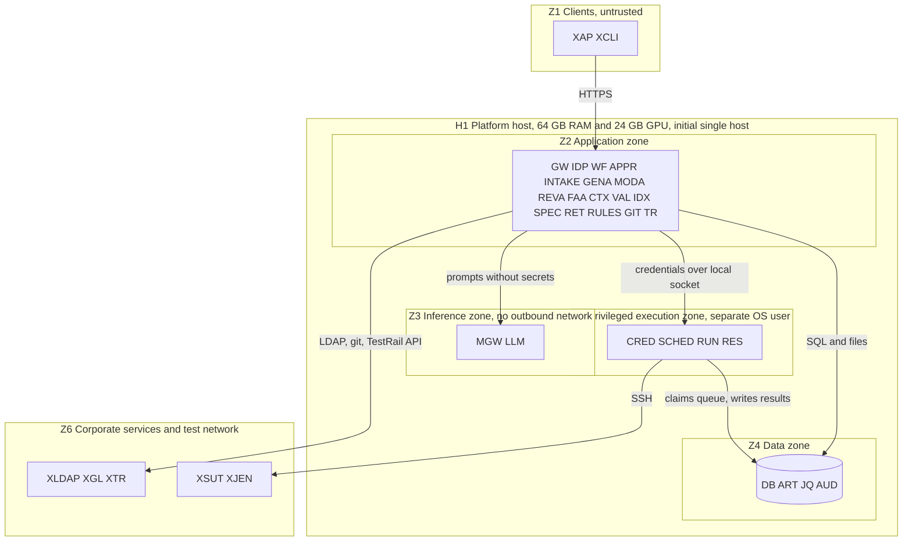
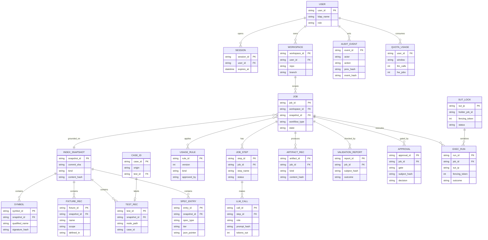
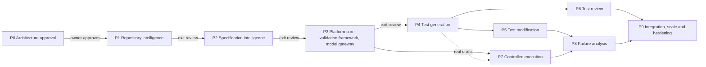

# Architecture — AI Agentic Test Engineering Platform

| Item | Value |
|---|---|
| Status | **DRAFT for owner approval.** No application code is authorized or written. Phase 1 starts only after explicit approval and an explicit phase authorization (project instructions §10) |
| Revision / date | 1 · 2026-10-31 |
| Inputs | `Repository_analysis.md` (REPOSITORY_ANALYSIS rev 3), `Decisions.md` (DECISIONS rev 1), `Open_questions.md` (OPEN_QUESTIONS rev 3), project instructions §1–§11 |
| Companion | `Architecture.mmd`: eight diagrams D1–D8. The diagrams shown here are embedded copies; §19 records the automated comparison of both files |
| Evidence labels | **[V]** verified in the supplied documents · **[U]** stated by the owner, not verifiable · **[A]** assumption · **[R]** recommendation · **[P]** proposed parameter, to be confirmed by the owner |
| Scope caveat | The production repository was never analysed and will not be shared (D-10). Everything about framework internals is taken from the dummy zip and the owner's statements. Production names, paths and signatures are **configuration read by the indexer at deployment**, never hard-coded |

---

## 1. Executive summary

**What is built.** A backend service that turns a user-defined test design into validated pytest functions, modifies and reviews existing ones, runs approved tests on a user-supplied SUT over SSH, and analyses failures. It is a **backend with a REST and tool interface** (D-03, Q-36 assumption). Chat sessions and login stay with the existing AI platform.

**Core design stance (five sentences).**

1. **Deterministic first, LLM second.** Indexing, spec lookup, validation, locking, scheduling, approvals and execution are deterministic code. The LLM only drafts, explains and hypothesizes inside typed, bounded workflow steps.
2. **The LLM is treated as untrusted.** Agents have read-only tools and return structured proposals. Only the workflow engine causes side effects, and only after validators and human approval gates.
3. **No fabricated facts.** Every API call, fixture, JSON key and Type B key in generated code must resolve to an indexed record with provenance, or the output is blocked.
4. **Hardware is a separate privileged plane.** A worker without model access runs fixed command templates on a locked SUT, under an approval bound to content hashes.
5. **One modular monolith plus one privileged worker, one PostgreSQL, one local inference server.** No microservices, no message broker, no graph database. Scale-out points are named but not built (ADR-01, ADR-03, ADR-10).

**Scope.**

| In scope | Out of scope (and why) |
|---|---|
| Five workflows: generate, modify, review, execute, analyse failure | Chat UI and login (D-03; until Q-36 is answered) |
| Repository and specification intelligence, deterministic validation | Opening merge requests, choosing reviewers (Q-43 assumption: user opens the MR) |
| SSH execution on user-supplied SUTs with locking and approval | Any write to TestRail (D-06: read only) |
| Commit of **test files only** to the user's branch, as the user | Changes to `lib/`, conftest, JSON, YAML, `config/` (blocked by V-20; project instructions §1) |
| Multi-user operation, quotas, audit, local deployment | External LLM APIs or hosted services of any kind (D-01) |

**Ten decisions that shape everything** (full list with alternatives in Appendix A).

| # | Decision | ADR |
|---|---|---|
| 1 | Modular monolith plus isolated execution worker | ADR-01 |
| 2 | Typed workflows, not autonomous agent loops | ADR-02 |
| 3 | PostgreSQL for metadata, full text and vectors; no graph store (R-6) | ADR-03 |
| 4 | Platform runtime separate from the pinned Python 3.8 validation toolchain | ADR-04 |
| 5 | SSH worker with fixed command templates; no model-generated shell | ADR-05 |
| 6 | Run the approved draft as an overlay on the SUT; commit only after a validated run | ADR-06 |
| 7 | Credential broker, memory only, per session (R-5) | ADR-07 |
| 8 | Validation gate is code, not prompt | ADR-08 |
| 9 | Replaceable local-inference abstraction | ADR-09 |
| 10 | PostgreSQL-backed job queue, own SUT lock with fencing tokens | ADR-10 |

---

## 2. Inputs, constraints and treatment

### 2.1 How each owner constraint is treated

| Constraint (source) | Architectural treatment | Where |
|---|---|---|
| Local-only inference, all data confidential (D-01) | No outbound network from the inference zone; no telemetry; model weights imported offline with checksums | §11, §13 |
| 64 GB RAM, one 24 GB GPU (D-02) | Model chosen by benchmark on synthetic framework tasks, not by leaderboard; embeddings on CPU; capacity model in §12 | §7.5, §12 |
| Integrate into existing AI platform later (D-03, Q-36) | REST plus tool descriptors; replaceable identity adapter | §14 |
| SSH to user-supplied Ubuntu SUT; CLI and Jenkins also launch (D-04) | SSH worker is a third launch path; own lock and pre-flight | §8.4 |
| "IP supplied means available" (D-05) | Respected as the owner's rule, but contradicting evidence from pre-flight is shown and blocks by default (R-1 verdict) | §2.2, §8.4 |
| TestRail read-only, tool never blocked (D-06, D-15) | Optional connector with timeout; manual case ID and procedure always accepted | §4, §16 |
| GitLab, LDAP, user branch, 2–3 level MR review (D-07) | Git operations run as the user; review stays in GitLab; platform adds its own pre-commit gate | §8.1, §9 |
| Runs 5–10 min, cap 30 min, ask before longer (D-08) | Soft timeout 10 min, hard cap 30 min, extension gate GT5 | §8.4, §9 |
| No operation barred (D-09) | No API denylist. Privileged operations are **labelled and approved, not forbidden** | §10, §11 |
| Confidential examples, dummy plus synthetic development (D-10) | Everything environment-specific is configuration; evaluation sets are synthetic; owner-run validation kit | §5, §17 |
| Python 3.8, pytest 7.3.2, Black 120 skip magic trailing comma, Pylint (D-11) | Pinned validation environment, separate from the platform runtime | §10, ADR-04 |
| Spec selection is a black box (D-12) | Platform never reimplements selection; static registries only | §6 |
| Type B shape and location (D-13, Q-41) | Catalogue stores full path custom → form factor → key | §6 |
| Guidelines authoritative (D-14, G-1…G-9) | Convention validator | §10 |
| Utility failure contracts (D-17) | Generator and reviewer rely on them; failure analysis maps them to classes | §8.5, §10 |
| Empty JSON entries are defects (D-18) | Validator error, "undefined, do not generate" | §6 |
| Logs are `.log` and `.html` (D-16) | Parsers in Phase 8; formats supplied then | §8.5 |

### 2.2 Verdicts on the recommendations R-1 … R-6 (DECISIONS asks the architecture to confirm or reject)

| ID | Verdict | Architecture decision |
|---|---|---|
| R-1 | **Confirmed, with a defined override** | Own lock per SUT IP plus SSH pre-flight. Default policy `block` when activity is found. The user may override only by re-confirming GT2 with the pre-flight evidence displayed; the override is audited. This honours D-05 (the owner decides) without hiding evidence |
| R-2 | **Confirmed in full** | (a) the model never has a shell; (b) approval before every hardware run, naming the SUT; (c) firmware commit needs a user-declared firmware file that pre-flight finds on the SUT and hashes (AQ-06 defines "valid"); (d) full audit |
| R-3 | **Confirmed** | Placeholder `CASE_ID_PENDING_<n>`, commit blocked (V-12, GT3) |
| R-4 | **Confirmed and tightened** | YAML read as key paths only, via a parser that never constructs values; `config/binary` never read; canary tests in Phase 1 |
| R-5 | **Confirmed** | Credential broker, memory only, per session, capability-based leases (ADR-07) |
| R-6 | **Confirmed** | PostgreSQL with full text and pgvector. Class hierarchy and shallow call graph fit recursive SQL; a graph store would add a component without a query that needs it (ADR-03) |

---

## 3. Design principles and quality targets

| # | Principle | Mechanism |
|---|---|---|
| DP-1 | Source of truth is the repository | Indexer reads the real repository at deployment; docs and prompts never override it |
| DP-2 | Verified, assumed and recommended are labelled | Every generated artifact carries a provenance manifest: which facts were resolved, which were user-supplied, which are placeholders |
| DP-3 | Minimal, reuse-first change | Write scope limited to test files (V-20); modifications limited to target functions (V-17) |
| DP-4 | Untrusted input everywhere | Repository text, logs, docstrings, TestRail text are data blocks, never instructions (§7.4) |
| DP-5 | Humans approve every side effect | Seven gates GT0–GT6, approvals bound to content hashes (§9) |
| DP-6 | Expected values are never edited to pass | V-16 plus failure-analysis rule (§8.5) |
| DP-7 | No claim without evidence | "Validated" only with a stored validator report or run ID; failure analysis cites evidence (§8.5) |
| DP-8 | Everything environment-specific is configuration | RepoConfig, command templates, marker lists, privileged tags (§5.2) |
| DP-9 | Idempotent, resumable work | Jobs are persisted state machines; a new chat can resume from the job record (§8, §13) |
| DP-10 | Incremental scalability | One host first, named scale-out triggers (§12) |

| Quality attribute | Measurable target [P] | Verified in |
|---|---|---|
| Correctness gate | 0 accepted outputs with unresolved symbols, unknown spec keys or convention violations | P4, P5 |
| Safety | 0 hardware runs without a valid GT2; 0 double lock grants | P7 |
| Confidentiality | 0 canary secrets in stores, logs, prompts; 0 unapproved outbound connections | P1, P3, P9 |
| Auditability | 100% of approvals, runs, commits and credential uses in a hash-chained log | P3 |
| Responsiveness | Non-LLM API p95 ≤ 500 ms; interactive LLM queue wait p95 ≤ 60 s at the target arrival rate | P9 |
| Recoverability | RTO ≤ 4 h, RPO ≤ 24 h; index rebuildable from the repository | P9 |

---

## 4. System view and component responsibilities

Read D1 from the left: external clients enter through `GW`; `WF` drives agents and deterministic services; only `RUN` reaches a SUT; only `GIT` reaches GitLab; only `MGW` reaches the model; `AUD` receives events from every privileged component.

### 4.1 Components

Operation names are contracts for later phases, not code. "Zone" refers to §11.2. "Phase" is the phase that first delivers a working version.

<!-- T:components -->
| ID | Component | Responsibility | Key operations (interface) | Owns | Zone | Phase |
|---|---|---|---|---|---|---|
| `GW` | API gateway and tool interface | Terminate REST and SSE, validate request schemas, rate limit, idempotency keys, expose tool descriptors for the existing platform | `POST /v1/jobs`, `GET /v1/jobs/{id}`, events stream, `POST …/approvals/{gate}`, `POST …/cancel`, `POST /v1/session/credentials`, `GET /v1/tools` | none | Z2 | P3 |
| `IDP` | Identity and access adapter | Authenticate (LDAP bind or token from the existing platform), map to roles, enforce authorization and quotas | `authenticate`, `authorize(user, action, resource)`, `quota_check` | `USER`, `SESSION`, `QUOTA_USAGE` | Z2 | P3 |
| `WF` | Workflow engine | Persisted state machine per job, step execution, bounded retry and repair loops, gate integration, cancellation, crash recovery | `create_job`, `advance`, `resume`, `cancel`, `get_state` | `JOB`, `JOB_STEP`, `ARTIFACT_REC`, `VALIDATION_REPORT` | Z2 | P3 |
| `APPR` | Approval service | Create approval requests bound to a subject hash, check approver authority and expiry, invalidate on content change | `request(gate, subject_hash, view)`, `decide`, `verify(approval_id, subject_hash)` | `APPROVAL` | Z2 | P3 |
| `INTAKE` | Intake agent | Turn a free-text or TestRail-based design into a structured `TestDesign`; list missing inputs and ambiguities | `parse_design(text, attachments, target_context)` | none | Z2 | P4 |
| `GENA` | Generator agent | Draft new test functions from a confirmed design, using only grounded symbols | `generate(design, context_pack)` | none | Z2 | P4 |
| `MODA` | Modifier agent | Produce a minimal patch for named tests from a change request | `modify(change_request, baseline, context_pack)` | none | Z2 | P5 |
| `REVA` | Reviewer agent | Semantic review after deterministic checks; every finding cites evidence | `review(subject, validator_report, context_pack)` | none | Z2 | P6 |
| `FAA` | Failure analysis agent | Hypothesize root cause from verified evidence; propose a fix as a modify request | `analyze(evidence_pack)` | none | Z2 | P8 |
| `CTX` | Context assembler | Build context packs with provenance, token budgets and injection-safe delimiting | `build_pack(task, target_context, budget)` | none | Z2 | P3 |
| `MGW` | Model gateway | Queue, priority, quotas, timeouts, constrained decoding, prompt-template versioning, redaction, call metadata | `complete(role, template_id, schema, priority)`, `embed(texts)` | `LLM_CALL` | Z3 | P3 |
| `LLM` | Local inference server | Serve the generation model and the embedding model; no network egress | engine API behind `MGW` only | model weights | Z3 | P3 |
| `IDX` | Repository intelligence | AST indexer, docstring parser, fixture scope resolver, test catalogue, case-ID registry, health report | `index(snapshot)`, `resolve_symbol`, `get_signature`, `resolve_fixtures(test_path)`, `find_tests`, `case_id_exists`, `health_report` | `INDEX_SNAPSHOT`, `SYMBOL`, `FIXTURE_REC`, `TEST_REC`, `CASE_ID` | Z2 | P1 |
| `SPEC` | Specification intelligence | Type A and Type B registries, JSON validator, DWORD conflict check, spec pack for a design | `type_a_lookup`, `type_b_has_key`, `check_dword_conflict`, `validate_json`, `spec_pack` | `SPEC_ENTRY` | Z2 | P2 |
| `RET` | Hybrid retrieval | Exact, full-text and vector search over docstrings, tests and rules | `search(query, kinds, filters, k)`, `similar_tests(design, folder)` | search indexes | Z2 | P1 |
| `RULES` | Usage rules and policy store | Versioned API usage rules, privileged-operation tags, scenario recipes, deny patterns, convention config | `get_rules(scope)`, `propose_change`, `publish(version)` | `USAGE_RULE` | Z2 | P1 |
| `VAL` | Deterministic validation pipeline | Run the check catalogue V-01…V-21 on any proposal | `validate(proposal, level)`, `list_checks` | none (stateless) | Z2 | P3 |
| `GIT` | GitLab connector and workspaces | Per-job workspaces, read-only snapshots for the indexer, diff, patch apply, commit and push as the user | `read_snapshot`, `prepare_workspace`, `diff`, `apply_patch`, `commit_and_push` | `WORKSPACE` (directories) | Z2 | P1 |
| `TR` | TestRail connector | Fetch cases by ID or filter; optional, time-limited, never blocking | `fetch_case`, `search_cases` | none | Z2 | P4 |
| `CRED` | Credential broker | Hold LDAP and SSH secrets in memory per session; issue short-lived capabilities | `put(session, kind, ttl)`, `lease(session, purpose)`, `revoke` | none persistent | Z5 | P3 |
| `JQ` | Job queue | PostgreSQL-backed queue using row locking (`SKIP LOCKED`) | `enqueue`, `claim`, `ack`, `nack` | queue tables | Z4 | P3 |
| `SCHED` | Scheduler and SUT lock manager | Per-SUT FIFO with per-user limits, leases with heartbeat, fencing tokens, SUT status | `acquire(sut_ip, job)`, `heartbeat`, `release`, `mark_needs_attention`, `sut_status` | `SUT_LOCK` | Z5 | P7 |
| `RUN` | Execution worker | SSH execution from a fixed template: pre-flight, stage, collect-only check, run under watchdog, collect, clean up, reconcile | `execute(run_spec, token)`, `cancel(run_id)`, `reconcile(run_id)` | `EXEC_RUN` | Z5 | P7 |
| `RES` | Result collector | Ingest raw results, store artifacts, parse JUnit, `.log`, `.html` | `ingest`, `parse_junit`, `parse_log`, `parse_html` | none | Z5 | P7 |
| `DB` | PostgreSQL | Relational data, full text, pgvector, queue tables, audit table | SQL | all tables | Z4 | P3 |
| `ART` | Artifact store | Drafts, diffs, reports, raw logs on encrypted local disk | file API with ACL by job | files | Z4 | P3 |
| `AUD` | Audit and observability | Append-only hash-chained audit, structured logs, metrics, alerts | `emit(event)`, `verify_chain` | `AUDIT_EVENT` | Z4 | P3 |

External systems:

<!-- T:externals -->
| ID | System | Role and protocol | Zone |
|---|---|---|---|
| `XAP` | Existing AI platform | Chat, sessions, login, model hosting for other uses; calls `GW` over HTTPS (Q-36) | Z1 |
| `XCLI` | Dev CLI and REST client | Used during development before integration | Z1 |
| `XLDAP` | LDAP directory | User authentication and group lookup (D-07) | Z6 |
| `XGL` | GitLab | Clone, branch, push as the user; MR review stays here (D-07) | Z6 |
| `XTR` | TestRail | Read-only case fetch (D-06) | Z6 |
| `XSUT` | SUT hosts and DUT | Ubuntu hosts running the framework and pynvme, reached by SSH (D-04) | Z6 |
| `XJEN` | CLI and Jenkins launches | Other users of the same SUTs; invisible to the platform (Q-44) | Z6 |

### 4.2 Agent roles are components with narrow powers

| Agent | Allowed read tools | Output (schema-validated) | Forbidden |
|---|---|---|---|
| `INTAKE` | `ctx.build_pack`, `tr.fetch_case`, `idx.find_tests` | `TestDesign` + open issues | any write, any hardware |
| `GENA` | `ctx.build_pack`, `idx.resolve_symbol`, `spec.type_b_has_key`, `val.validate(dry_run)` | `Proposal` (new files) | writing files, git, SSH |
| `MODA` | same as `GENA` + `git.diff` (read) | `Proposal` (patch) | writing files, touching code outside targets |
| `REVA` | `ctx.build_pack`, `idx.*`, `spec.*`, `val.validate(dry_run)` | `ReviewReport` | any write |
| `FAA` | `ctx.build_pack`, `idx.*`, `spec.*`, evidence reader | `Analysis` (+ optional `Proposal`) | editing expected values, starting runs |

The model never calls `GIT`, `RUN`, `SCHED`, `CRED` or `APPR`. Those are reachable from `WF` only.

---

## 5. Repository intelligence (`IDX`, `RET`, `RULES`)

### 5.1 Purpose and principle

`IDX` converts the repository into **deterministic registries** that all other components query. It reads the real repository at deployment (D-10, Q-30). It never guesses: an unparseable file is reported, not approximated (REPOSITORY_ANALYSIS §10).

### 5.2 Configuration-driven discovery (DP-8)

`RepoConfig` is the only place where production names live. Keys (values are filled by the owner at deployment; no values are in this document):

| Key group | Content |
|---|---|
| roots | `lib/`, `tests/`, `config/product/`, JSON spec root(s), `config/binary/` (deny-listed) |
| conftest files | root `conftest.py`, `tests/conftest.py`, `pynvme_conftest.py` locations (D-14, Q-32) |
| tool configs | `pytest.ini` (markers), `pylintrc`, Black settings (D-11) |
| utility module | real module name, `general_utilities` (Q-30) |
| schema-only files | YAML globs: key paths only |
| deny list | `config/binary/**`, YAML values, credential files |
| consumer map | which Python module consumes which JSON family (byte or bit semantics, §6.4) |

### 5.3 Pipeline and registries

| Stage | Input | Output registry | Consumers |
|---|---|---|---|
| Discover | `RepoConfig`, git tree | file list with hash and parse status | health report |
| Parse Python | AST (Python 3.8 grammar) | `SYMBOL`: module, class, method, signature, defaults, decorators, base classes | `VAL`, `CTX`, `RET` |
| Parse docstrings | `@Author/@Description/@Input/@Returns/@Note` [V: REPOSITORY_ANALYSIS §1] | structured fields per symbol | `CTX`, `RET` |
| Resolve conftest scopes | conftest files, directory tree | `FIXTURE_REC`: name, scope, autouse, params, location, teardown (yield) | `VAL` V-04, `GENA` |
| Catalogue tests | `tests/**` | `TEST_REC`: path, function, case ID, markers, fixtures, APIs called, parametrization | `RET`, `VAL` V-09/V-12 |
| Case-ID registry | test docstrings and names | `CASE_ID` unique index | V-12 |
| JSON and config | spec JSON, `config/product/**` | handed to `SPEC` (§6) | `SPEC` |
| YAML schema | YAML files | key paths only, parsed with a node-level reader that never builds value objects | `CTX` (key names only) |
| Rules ingest | `RULES` store | usage rules, privileged tags, recipes | `VAL`, `CTX` |
| Embed | docstrings, test summaries | vectors in `DB` (CPU embedding model) | `RET` |
| Health report | all stages | counts, parse failures, regex-fallback files, unresolved imports | owner, `WF` degraded-mode decisions |

Non-parseable files (the dummy zip has `nvme_utils.py`, [V] REPOSITORY_ANALYSIS §1) get a regex outline marked `FALLBACK`; generation that touches a symbol from a `FALLBACK` file is flagged "low assurance" and requires explicit user acknowledgement at GT0.

### 5.4 Snapshots, freshness, isolation

| Topic | Design |
|---|---|
| Base snapshot | Indexed from a read-only checkout of the configured default branch; credential decision in AQ-01 |
| User overlay | Per job: branch HEAD plus staged proposal, indexed incrementally (changed files only) and visible only to that user |
| Trigger | Webhook or poll on default branch, nightly full verification, on-demand for a branch |
| Reproducibility | Every job stores `snapshot_id` and `content_hash`; prompts and reports cite it |
| Cost [A] | About 13k tests and 5 MB corpus (Q-28): a few tens of thousands of chunks; full re-index is minutes, incremental seconds (measured in P1-AC6) |

### 5.5 Retrieval (`RET`) and the API usage-rule store (`RULES`)

* Lookup order: exact symbol → fixture → full text (BM25 over docstrings) → vector. Exact lookups never go through the LLM.
* Sibling-test retrieval: nearest tests in the same target folder supply the style grounding (naming, docstring layout, fixture use).
* `RULES` holds what code cannot reveal: call-order and teardown rules (Q-21; example [V]: recreate namespaces after random `IOWorker` fill; `fill_namespace` takes `drive_percent` **or** `size`), privileged-operation tags, **scenario recipes** (the ten scenario types in OPEN_QUESTIONS §B as human-approved skeletons the model fills in), deny patterns.
* Changes to `RULES` are versioned and need **GT6** (maintainer approval). The LLM may *propose* a rule, never publish one.

---

## 6. Specification intelligence and resolution (`SPEC`)

### 6.1 Principle

The framework's `select_specification` (Type A) and `get_constant_values` (Type B) are authoritative at runtime and are **black boxes** (D-12). `SPEC` does not reimplement selection. It builds **read-only static registries with provenance** so that generation, review and failure analysis can reject anything not defined, and it surfaces conflicts to a human instead of resolving them silently.

### 6.2 Registries

| Registry | Source | Content | Provenance per entry |
|---|---|---|---|
| Type A | JSON under the spec root: `base_spec` and each `product_spec/<vendor>` tier [V: §7.1] | opcode, feature ID, `cdwNN_vars` (field → bit width), enumerations (`*_length`), data structures, headers, response structures | file, tier, JSON pointer, content hash, snapshot |
| Type B key catalogue | `config/product/**` (D-13) | full path custom → form factor → key, nested structures, value type; values are **not** copied unless the key is marked non-sensitive in `RepoConfig` | same |
| Merge view | Type B: `base_spec` deep-merged with vendor JSON key by key (D-12) | the view the framework would see for a given target context | list of contributing tiers |
| Library provenance | static scan of `lib/` for hard-coded `base_spec` paths (Q-23) | per-library flag "tier fixed to base_spec" | file, line |

### 6.3 Target context and resolution rules

The user states a **target context** at GT0: custom, form factor, optional firmware vendor, spec version. It selects the merge view for *static validation only*. Runtime selection remains the framework's.

| Rule | Statement |
|---|---|
| S-1 | A Type B key used in generated code must exist in the merge view for the target context. Keys are unique per form factor, not globally (D-13), so lookups include the form factor |
| S-2 | Nested keys: the catalogue stores the full path. Until Q-41 is answered, generation may only use keys already used by existing tests in the repository; any other nested access is flagged for a human decision |
| S-3 | Type A is validated against `base_spec` and, if a vendor is named, the vendor tier. Because merge-versus-swap semantics are unconfirmed (Q-23), results show provenance (`base only`, `vendor only`, `both, differs`) |
| S-4 | A **conflict** is: structure or type differs between tiers; widths disagree; the user's expected value contradicts the catalogue; JSON disagrees with a docstring. Differing *values* between base and vendor Type B are normal overrides, not conflicts. Conflicts are shown at GT0 with provenance and are never auto-resolved |
| S-5 | Expected values come from `get_constant_values(key)`. A literal expected value is allowed only if it appears in the user's design; the manifest records its origin |
| S-6 | Missing definition means `UNDEFINED`: the generator refuses and explains. Empty `{}` entries are errors (D-18), listed as "undefined, do not generate" |
| S-7 | When a DWORD is supplied the framework silently ignores the individual fields (Q-07, D-12). Generation and review must not pass both (V-06) |
| S-8 | Precedence for display is vendor tier over base tier [A: from folder semantics, REPOSITORY_ANALYSIS §7.5]; it is a display order, not an instruction to pick a winner |

### 6.4 JSON validation rules (deterministic)

| Rule | Check | Severity |
|---|---|---|
| J-1 | `cdwNN_vars` widths sum to 32 | warning (D-18 does not address widths; dummy: 32 of 34 blocks conform [V]) |
| J-2 | Empty `{}` entry | **error** (D-18) |
| J-3 | Unit family: `*_data_structure` is bytes at first level and bits at second when consumed by `datastructure.py`; all bits when consumed by `dword.py` (§1A.1 row 5 [V]). Consumer comes from `RepoConfig` | error if the consumer is unknown |
| J-4 | Enumerations carry `*_length` and named hex values | warning |
| J-5 | Opcode and feature ID are hex strings and match the code's `op_code`/`feature_id` strings | error |
| J-6 | Variable values supplied by users are hex strings and fit the declared width | error (V-05) |
| J-7 | Referenced JSON file exists | error in production; in the dummy this is a known artifact [V] |

---

## 7. Agent orchestration (`WF`, agents, `CTX`, `MGW`, `LLM`)

### 7.1 Workflows, not free-running agents (ADR-02)

Each of the five workflows is a **typed graph of steps** executed by `WF`. A step is either deterministic (a service call) or a bounded LLM step with a schema-validated output. The graph, not the model, decides what happens next. This keeps behaviour testable, resumable and auditable, and it limits what a manipulated model can do.

| Workflow | Type tag | Steps (summary) | Ends in |
|---|---|---|---|
| Generate | `GENERATE` | intake → ground → GT0 → generate → validate ⇄ repair → GT1 → [GT2 → run → analyse] → GT3 | commit or report |
| Modify | `MODIFY` | locate → baseline → impact → GT0 → patch → validate ⇄ repair → GT1 → [run] → GT3 | commit |
| Review | `REVIEW` | locate → validate (deterministic) → semantic review → report | report, read-only |
| Execute | `EXECUTE` | verify approved draft → GT2 → queue → lock → pre-flight → stage → collect-only → run → collect → cleanup | run record |
| Analyse failure | `ANALYZE` | evidence → classify → hypothesize → verify → report → [fix proposal → GT4 → modify] | report |

### 7.2 Step contracts and loop bounds [P]

| Parameter | Default [P] | Reason |
|---|---|---|
| Repair iterations (validate → repair) | 3 | bounded cost; diagnostics are deterministic so repairs converge or stop |
| Schema-violation retries per LLM step | 2 | then the step fails to `FAILED` with the raw output stored |
| Tool calls per agent step | 8 | prevents retrieval loops |
| LLM call timeout | 120 s | model gateway enforces it, job gets a retryable error |
| Approval expiry | 24 h | content hashes make older approvals unusable after any change |
| Job idle expiry | 7 days | frees workspaces |

Repair prompts are built **from validator diagnostics** (rule ID, location, evidence), not from free text. After the last iteration the job stops with the diagnostics shown to the user; it never relaxes a rule.

### 7.3 Context assembly (`CTX`)

A **context pack** is assembled deterministically and has a fixed layout.

| Section | Content | Trust |
|---|---|---|
| Task | the structured `TestDesign` or change request | user input, confirmed at GT0 |
| Target context | custom, form factor, vendor, spec version | user input |
| Grounded symbols | signatures and docstring fields for APIs the design needs | verified (IDX) |
| Fixtures | resolved by directory scope, nearest first | verified |
| Spec pack | only the Type A and Type B entries relevant to the design, with provenance | verified (SPEC) |
| Sibling tests | 3–5 nearest tests in the target folder | repository text, data |
| Usage rules and recipe | matching `RULES` entries | curated |
| Conventions | G-1…G-9 summary | curated |
| Output schema | required structure | fixed |

Budgets are enforced per section so a long log cannot crowd out grounding. Retrieved text is wrapped in delimited data blocks with source IDs; the system prompt states that data blocks contain no instructions.

### 7.4 Prompt injection and untrusted content (project instructions §5)

Docstrings, test files, logs, TestRail text and generated code are untrusted. The design assumes the model **can** be steered and limits the damage:

1. Agents hold read-only tools; every effect goes through `WF` after validators and a human gate.
2. Outputs are schemas, parsed and re-validated; free text is never executed.
3. Command templates for hardware are fixed; model output can only select among approved node IDs (§8.4).
4. Control tokens and role markers are stripped from retrieved text; instruction-like phrases in data blocks are logged as events (T-01).
5. Adversarial corpora (≥ 100 payloads in docstrings, logs, test data) are part of the P9 acceptance suite.

### 7.5 Model gateway and local inference (`MGW`, `LLM`; ADR-09)

| Topic | Design |
|---|---|
| Roles | `generation` (code and reasoning), `embedding`; a small router role is optional and may reuse `generation` |
| Abstraction | `MGW` exposes `complete` and `embed`; the engine behind it is replaceable (single process now, separate inference host later) |
| Scheduling | priority queue: interactive (`INTAKE`, review, short fixes) above batch (embedding, re-index); per-user fair share; per-user quotas [P] |
| Output control | constrained decoding to JSON schema where the engine supports it; otherwise parse-validate-retry (7.2) |
| Efficiency | shared system prompts and context prefixes cached by the engine; output length limits per role |
| Model selection | **Benchmark, not leaderboard.** Candidates are sized by weight memory plus context memory on 24 GB. Rule of thumb [A]: 4-bit weights ≈ 0.5–0.6 GB per billion parameters, so a 14B-class model ≈ 8–9 GB and leaves most of the card for context and batching; a ~30B-class model leaves little. Phase 3 produces the benchmark report on synthetic framework tasks (P3-AC5); the smallest model that meets the Phase 4 targets is selected |
| Supply chain | weights imported offline with checksums, pinned engine version, no remote code execution at load |
| Records | `LLM_CALL`: role, template ID and hash, prompt hash, token counts, latency; prompt text is stored only if the owner enables it (AQ-07) because prompts contain confidential code |

---

## 8. Workflows: data flow, gates and errors

### 8.1 Generate (`GENERATE`) and Modify (`MODIFY`)

**Data flow.**

1. `GW` authenticates, checks quota, creates the job with workspace, branch and target context.
2. `INTAKE` builds a `TestDesign` (objective, steps, expected results, case IDs, target API area). Missing items go to `CLARIFYING`; nothing is guessed. Case IDs come from the user or `TR`; absent IDs become the marked placeholder (R-3).
3. `CTX` assembles grounding. **Placement is deterministic:** folder and file derive from G-1/G-2 and the API area; `t<X>` is the next free number; at 25 tests a new `grp<X+1>` file is created (G-3). PLDM and peripheral paths follow Q-42 assumptions or the user's explicit path.
4. **GT0** shows the parsed design, target context, resolved APIs, spec conflicts, `FALLBACK` warnings, placeholders and every assumption. The user confirms or amends.
5. The generator or modifier drafts; `VAL` validates; diagnostics drive up to three repairs.
6. **GT1** shows the diff and the full validation report, bound to their hashes. Approval applies the proposal to the **job workspace only**.
7. Without a run, the job moves to GT3 (commit). With a run, §8.4 follows.

**Modify specifics.** Baseline comes from branch HEAD in the workspace. The change request names target functions (by path, node ID or case ID). V-17 requires the AST outside the targets to be unchanged, case ID and parametrization IDs to be preserved unless the user asks otherwise, and formatting-only edits outside the targets to be absent. If a modified file would exceed 25 tests, placement follows G-3.

**Errors.** Missing input → `CLARIFYING`. Unresolved symbol or unknown key → repair, then `FAILED` with diagnostics. Index degraded (`FALLBACK`, stale snapshot) → warning at GT0, never silent. Model unavailable → job stays queued with a retryable error (E-01).

### 8.2 Review (`REVIEW`)

1. Locate target tests (path, folder, diff or case IDs) in the workspace snapshot.
2. Run the deterministic catalogue (§10) in review mode: findings carry rule ID, location, evidence.
3. `REVA` adds semantic findings (one objective per test, G-9; steps cover expected results; teardown and ordering rules from `RULES`; negative-test completeness). **A semantic finding without a location and cited evidence is dropped.**
4. Output: `ReviewReport` with findings tagged `deterministic` or `model-judged`, optional patch proposals (which re-enter the Modify workflow, never applied directly).

Review is read-only: no workspace writes, no hardware.

### 8.3 Test design confirmation and assumptions

Unclear requirements are asked, not assumed (the project rule "never invent"; OPEN_QUESTIONS defaults are shown to the user as assumptions with their Q-IDs).

### 8.4 Controlled execution (`EXECUTE`)

**Preconditions (checked by `WF` before GT2 is offered).** Draft validated and approved at GT1; node IDs derived from the approved files; privileged operations classified (V-13); SUT IP, branch and commit stated; firmware file declared if a firmware commit is tagged (R-2c); timeouts shown.

**GT2 content (hash-bound).** SUT IP; repository commit; hashes of overlay files; exact node IDs; privileged-operation list with the APIs that cause them; pre-flight policy; soft and hard timeouts; credential source. Any change after approval voids it.

**Run procedure in `RUN`** (all steps from a fixed template; command arguments come only from validated fields):

| Step | Action | Failure handling |
|---|---|---|
| 1 | Connect, verify the pinned SSH host key | stop, `FAILED` E-08 |
| 2 | Pre-flight: pytest or pynvme processes (patterns from config), working-tree state, Python and pytest versions equal the pins, disk space, firmware file and hash if declared | busy → `BLOCKED_SUT_BUSY` (R-1); other failures → stop with the evidence |
| 3 | Stage: fetch and check out the pinned commit in the configured working directory, copy overlay files, verify hashes | mismatch → stop, clean up |
| 4 | Collect-only with `--strict-markers`: the collected set must **equal** the approved node IDs | any difference → abort (V-19) |
| 5 | Run pytest under the watchdog; JUnit XML, `.log`, `.html` output enabled by the command template (Phase 7 input) | soft timeout → ask GT5; hard cap → terminate process group |
| 6 | Fetch artifacts, remove overlay files, restore tree state | cleanup failure → SUT `NEEDS_ATTENTION` |
| 7 | Optional restore hook (configured command template, e.g. framework recovery); D-09 allows restore operations | failure → `NEEDS_ATTENTION` |
| 8 | Release lock with fencing token | if remote process still alive → lock **not** released |

**Locking.** One lock row per SUT IP with owner, lease, heartbeat and a monotonically increasing fencing token; `RUN` re-checks the token before each phase so a stale worker cannot act. FIFO queue per SUT with a per-user limit of one active hardware job [P]. SUT states: `AVAILABLE_ASSUMED` (D-05 default), `LOCKED`, `BUSY_EXTERNAL`, `NEEDS_ATTENTION`. A `NEEDS_ATTENTION` SUT requires an explicit user acknowledgement before the next job.

**Where code runs.** The overlay approach (ADR-06) keeps the user's branch clean until a run validates the draft. Whether the SUT may reach GitLab, where the checkout lives and whether the tree is shared are Q-37/AQ-03. The strategy sits behind a `WorkspaceStrategy` setting so a different choice changes configuration, not design.

**Privileged operations.** Labels in `RULES` cover at least the operations REPOSITORY_ANALYSIS §10 lists: power cycle, Quarch actions, `DriveDoctor` restores, firmware download/commit, format, sanitize, namespace deletion, lockdown. Detection is a shallow call-graph walk over the registry; **dynamic or unresolved calls count as privileged**. Labels inform the approval; they do not forbid anything (D-09).

**Errors.** Credential expired → ask the user to re-authenticate, job stays queued. SSH loss during a run → reconcile by tagged process lookup; never assume. Platform restart during a run → `RUN.reconcile` on start; the lock stays until the remote process is verified gone.

### 8.5 Failure analysis (`ANALYZE`)

<!-- T:fa_steps -->
| ID | Stage | Deterministic or model | Detail |
|---|---|---|---|
| `FA1` | Collect evidence | deterministic | JUnit XML, `.log`, `.html`, console, run metadata, commit, SUT pre-flight data |
| `FA2` | Extract facts | deterministic | Phase (setup, call, teardown, from the `pytest_runtest_makereport` hook outcome [V]), exception type and message, frames, assertion origin |
| `FA3` | Map frames to the repository | deterministic | Frame → test file, library, conftest, via `IDX` |
| `FA4` | Rule-based classification | deterministic | See class table; a decisive class skips to `FA8` |
| `FA5` | Spec and data checks | deterministic | `SPEC`: key presence, DWORD conflict, undefined entries |
| `FA6` | History comparison | deterministic | Earlier runs of the same test and branch diff |
| `FA7` | Hypothesis | model, bounded | Must cite evidence IDs; may answer "insufficient evidence" |
| `FA8` | Evidence verification | deterministic | Every claim must resolve to a log line, frame or file location, otherwise it is downgraded |
| `FA9` | Report | deterministic | Class, confidence, evidence list, next actions |
| `FA10` | Fix proposal | model, bounded | Enters the Modify workflow; V-16 applies; GT4 required |

| Class | Meaning | Typical deterministic signals |
|---|---|---|
| C1 | Test-script defect | exception in the test file, wrong call, wrong fixture use, `AssertionError` caused by script logic |
| C2 | Spec or expected-value data issue | `KeyError` from `get_constant_values` (D-17), unresolved Type B key, expected value contradicting the catalogue |
| C3 | Suspected firmware or DUT behaviour | `compare_value`/`validate_output_values` `AssertionError` on a device-returned value, valid test, valid keys. Reported as a **hypothesis** with evidence, never as fact |
| C4 | Environment or infrastructure | SSH errors, timeouts, missing hardware, OOB transport errors (for example `PecError`, `MicError`, `SMBusError`, `PLDMTimeoutError` [V: class list in REPOSITORY_ANALYSIS §5.4/§5.5]) |
| C5 | Framework or library defect | exception inside `lib/` with a valid call |
| C6 | Non-deterministic | differing outcomes in comparable runs; confirmed only by a user-approved re-run |
| C7 | Unclassified | insufficient evidence |

**Rules.** The agent never edits expected values, Type B data or JSON to make a test pass (V-16, project instructions §5). If analysis concludes the expectation is wrong it produces a **spec discrepancy report** with citations for a human, not a patch. "Validated fix" means validators passed and, if a re-run was approved and executed, the run ID shows a pass; otherwise the report says "statically validated only".

---

## 9. Job state machine and approval gates

<!-- T:states -->
| ID | Meaning | Entered from | Leaves to |
|---|---|---|---|
| `RECEIVED` | Job created, inputs under review | start, `CLARIFYING` | `CLARIFYING`, `DESIGN_CONFIRMED`, `REJECTED` |
| `CLARIFYING` | Waiting for user answers | `RECEIVED`, `AWAITING_COMMIT_APPROVAL` | `RECEIVED` |
| `DESIGN_CONFIRMED` | GT0 approved | `RECEIVED` | `GENERATING`, `REVIEWING` |
| `GENERATING` | Agent drafts | `DESIGN_CONFIRMED`, `REPAIRING`, `AWAITING_FIX_APPROVAL` | `VALIDATING` |
| `VALIDATING` | Deterministic catalogue runs | `GENERATING` | `REPAIRING`, `FAILED`, `AWAITING_CHANGE_APPROVAL` |
| `REPAIRING` | Repair prompt from diagnostics | `VALIDATING` | `GENERATING` |
| `REVIEWING` | Semantic review | `DESIGN_CONFIRMED` | `COMPLETED` |
| `AWAITING_CHANGE_APPROVAL` | GT1 pending | `VALIDATING` | `AWAITING_RUN_APPROVAL`, `AWAITING_COMMIT_APPROVAL`, `REJECTED` |
| `AWAITING_RUN_APPROVAL` | GT2 pending | `AWAITING_CHANGE_APPROVAL` | `QUEUED_FOR_SUT`, `REJECTED` |
| `QUEUED_FOR_SUT` | Waiting for lock and pre-flight | `AWAITING_RUN_APPROVAL`, `BLOCKED_SUT_BUSY` | `BLOCKED_SUT_BUSY`, `RUNNING`, `CANCELLED` |
| `BLOCKED_SUT_BUSY` | Activity found on the SUT | `QUEUED_FOR_SUT` | `QUEUED_FOR_SUT` |
| `RUNNING` | Test execution on the SUT | `QUEUED_FOR_SUT` | `ANALYZING`, `FAILED`, `CANCELLED` |
| `ANALYZING` | Failure analysis and report | `RUNNING` | `AWAITING_FIX_APPROVAL`, `AWAITING_COMMIT_APPROVAL`, `COMPLETED` |
| `AWAITING_FIX_APPROVAL` | GT4 pending | `ANALYZING` | `GENERATING`, `REJECTED` |
| `AWAITING_COMMIT_APPROVAL` | GT3 pending | `AWAITING_CHANGE_APPROVAL`, `ANALYZING` | `COMPLETED`, `CLARIFYING`, `REJECTED` |
| `COMPLETED` | Terminal, success | several | end |
| `REJECTED` | Terminal, declined at a gate | gates | end |
| `FAILED` | Terminal, error | `VALIDATING`, `RUNNING` | end |
| `CANCELLED` | Terminal, user cancel with cleanup | non-terminal states | end |

<!-- T:gates -->
| ID | Gate | Trigger | Approver | Hash-bound subject | Shown to approver | On decline |
|---|---|---|---|---|---|---|
| `GT0` | Design confirmation | design parsed | job owner | `TestDesign`, target context, assumptions | design, resolved APIs and keys, conflicts, placeholders, low-assurance symbols | `REJECTED` or amend |
| `GT1` | Change approval | validators clean | job owner | diff and validation report | diff, full report, provenance manifest | `REJECTED` or amend |
| `GT2` | Hardware run approval | run requested | job owner (per run) | SUT IP, commit, overlay hashes, node IDs, privileged list, timeouts | all of those, plus pre-flight policy and any override | `REJECTED` |
| `GT3` | Commit approval | validated (and run, if requested) | job owner | final diff, run ID or "not run", case-ID status | placeholders block approval; firmware commit needs declared file | `REJECTED` or `CLARIFYING` |
| `GT4` | Fix approval | fix proposed after analysis | job owner | proposed patch and the analysis it rests on | evidence, class, guard result | `REJECTED` |
| `GT5` | Run extension | soft timeout would be crossed | job owner | run ID, new limit ≤ hard cap | elapsed time, log tail, reason | run is stopped at the soft limit |
| `GT6` | Rules and tags change | rule, privileged tag or recipe proposed | maintainer role | rule version diff | diff and rationale | no publish |

Approvals are owned by the job owner because they act under their identity (D-07); GitLab MR review (2–3 levels, D-07) remains an independent human control afterwards. Approval records store approver, time, subject hash and the displayed view hash.

---

## 10. Validation pipeline (`VAL`)

`VAL` is a rule engine. Each check has an ID, a source, a method and a severity. **Blocking** checks must pass before GT1 can be offered. The pipeline runs the same way for generation, modification and review.

**Pinned environment.** Checks that depend on the toolchain run in a separate virtual environment fixed to Python 3.8 and pytest 7.3.2 with Black and Pylint (D-11). The platform's own runtime may differ (ADR-04). `pylintrc` and `pytest.ini` come from the repository, not from the platform.

<!-- T:checks -->
| ID | Check | Basis | Method | Severity | Phase |
|---|---|---|---|---|---|
| `V-01` | Syntax and Python 3.8 validity | D-11, REPOSITORY_ANALYSIS §1A.1 row 13 | parse with 3.8 grammar, compile in pinned env, banned 3.9+ constructs list | blocking | P3 |
| `V-02` | Import resolution | DP-1 | each import maps to an indexed module, stdlib allow-list or pytest | blocking | P3 |
| `V-03` | Symbol and signature resolution (anti-hallucination gate) | REPOSITORY_ANALYSIS §10 | every call resolves to an indexed `file::Class.method`; keyword arguments are in the signature or in the JSON variable names for the `op_code`/`feature_id`, plus `statuscode`/`statuscodetype`; unresolved dynamic calls are blocking | blocking | P4 |
| `V-04` | Fixture resolution | D-14, Q-32 | each test parameter resolves nearest-first by directory; scope compatibility | blocking | P4 |
| `V-05` | Command-variable validity | §6.4 J-5/J-6 | op_code, feature_id, variable names, hex-string values and widths | blocking | P4 |
| `V-06` | DWORD versus individual parameters | Q-07 | flag calls supplying a DWORD and any of its fields | blocking | P2 |
| `V-07` | Type B key validity | D-12, D-13 | literal keys must exist in the merge view; non-literal keys flagged | blocking | P2 |
| `V-08` | Spec-family units and undefined entries | D-18, §1A.1 row 5 | byte/bit family by consumer; `{}` entries must not be used | blocking | P2 |
| `V-09` | Layout and naming G-1…G-6 | D-14 | path, file regex, ≤ 25 tests, name pattern, docstring fields, `@Case ID` equals name ID, `pytest.param` rules | blocking | P4 |
| `V-10` | Markers declared (G-7) | D-14 | markers parsed from `pytest.ini`; no duplicates | blocking | P4 |
| `V-11` | Formatting and lint (G-8) | D-11 | Black 120 skip-magic-trailing-comma, Pylint with project `pylintrc` | blocking (Black), blocking on error-level Pylint | P4 |
| `V-12` | Case-ID policy | R-3, D-15 | uniqueness against the registry; placeholder detection | blocking at GT3, warning before | P4 |
| `V-13` | Privileged-operation classification | R-2, §10 | shallow call graph, tags from `RULES`; unresolved means privileged | informational (feeds GT2) | P7 |
| `V-14` | Forbidden constructs | project instructions §5 | `subprocess`, `os.system`, `eval`, `exec`, sockets, network clients, writes outside a temp area. Not barred by D-09 for framework operations, but raw OS access in generated tests needs explicit acknowledgement at GT1 | blocking by default | P3 |
| `V-15` | Secret and confidential-data scan | R-4 | credential patterns and configured canaries in code, logs and reports | blocking | P3 |
| `V-16` | Expected-value guard | project instructions §5 | diffs may not alter Type B data, JSON specs, config or the expected argument of `compare_value`/`validate_output_values` without a human-supplied spec citation | blocking | P5 |
| `V-17` | Minimal-change scope | DP-3 | AST outside targets unchanged; case IDs and parametrize IDs preserved | blocking (modify) | P5 |
| `V-18` | Usage-rule compliance | Q-21, RULES | ordering, teardown and exclusivity rules (for example `fill_namespace` arguments, namespace recreation after random fill) | blocking for rules marked mandatory | P4 |
| `V-19` | Collection check on the SUT | §8.4 step 4 | `--collect-only --strict-markers`; collected set equals approved node IDs | blocking for runs | P7 |
| `V-20` | Write scope | project instructions §1 | only `tests/**` test files; no changes to `lib/`, conftest, `pytest.ini`, JSON, YAML, `config/` | blocking (fixture requests escalate, AQ-12) | P3 |
| `V-21` | Negative-test convention | REPOSITORY_ANALYSIS §5.1 | tests designated negative pass `statuscode` and `statuscodetype` through the command call | blocking when the design is negative | P4 |

Severity is data in `RULES`; blocking severity can only be relaxed through GT6. The LLM never grades its own output: `REVA` runs after `VAL`, not instead of it.

---

## 11. Security architecture

### 11.1 Assets and trust

Assets: repository source and specs (confidential, D-01), LDAP and SSH credentials, the SUTs and DUTs (hardware safety), user identity on commits, the audit log. The LLM, repository text, logs and generated code are **untrusted** (project instructions §5).

### 11.2 Trust zones and deployment placement

<!-- T:zones -->
| ID | Zone | Contents | Rules |
|---|---|---|---|
| `Z1` | Clients, untrusted | `XAP`, `XCLI` | HTTPS only to `GW`; every request authenticated |
| `Z2` | Application zone | `GW`, `IDP`, `WF`, `APPR`, `INTAKE`, `GENA`, `MODA`, `REVA`, `FAA`, `CTX`, `VAL`, `IDX`, `SPEC`, `RET`, `RULES`, `GIT`, `TR` | No SSH to SUTs, no model weights; outbound only to Z3, Z4, Z5 (local socket) and the allow-listed corporate services in Z6 |
| `Z3` | Inference zone | `MGW`, `LLM` | **No outbound network.** Receives prompts, returns completions. No access to repositories or credentials |
| `Z4` | Data zone | `DB`, `ART`, `JQ`, `AUD` | Encrypted disk, role-separated database accounts, no inbound from Z1 |
| `Z5` | Privileged execution zone | `CRED`, `SCHED`, `RUN`, `RES` | Separate OS user or container, only component with a route to SUT subnets, no route to Z3, no model access |
| `Z6` | Corporate services and test network | `XLDAP`, `XGL`, `XTR`, `XSUT`, `XJEN` | Reached only through allow-listed addresses |

### 11.3 Threats and controls

<!-- T:threats -->
| ID | Threat | Controls | Verified in |
|---|---|---|---|
| `T-01` | Prompt injection through docstrings, tests, logs, TestRail text | Read-only agent tools; schema outputs; delimited data blocks; token stripping; all effects behind validators and gates (§7.4) | P9 |
| `T-02` | Unsafe constructs in generated tests | V-14, V-20; GT1 shows the findings; no execution without GT2 | P3, P4 |
| `T-03` | Credential leak (LDAP, SSH) | `CRED` memory only, TTL, capability leases, log redaction, core dumps disabled, canary tests (ADR-07) | P3 |
| `T-04` | Run without valid approval, or command injection through node IDs, paths, branch names | Hash-bound GT2; fixed command template; argument allow-list regexes; collect-only equality (V-19) | P7 |
| `T-05` | Cross-user access to jobs, workspaces, artifacts | Row-level ownership, per-user directories with OS permissions, per-job workspaces; user-overlay index visible only to the owner | P3 |
| `T-06` | Confidential data egress | No outbound from Z3; default-deny egress from Z2 except Z6 allow-list; no telemetry; offline updates | P9 |
| `T-07` | Audit tampering | Hash chain with verifier; audit database role is insert-only | P3 |
| `T-08` | Malicious or unvetted model files or engine | Offline import with checksum, pinned versions, no remote-code loading | P3 |
| `T-09` | Runs colliding on a SUT used by CLI or Jenkins | Own lock, pre-flight busy check, default block, audited override (R-1) | P7 |
| `T-10` | Zombie worker acting after lease loss | Fencing tokens checked per phase; lock not released while remote process alive | P7 |
| `T-11` | Resource exhaustion (GPU queue flooding, giant logs) | Per-user quotas, priority classes, output limits, log size caps, queue depth alarms | P3, P9 |
| `T-12` | Expected values altered to force a pass | V-16 on every proposal, including fix proposals; spec discrepancy goes to a human | P5, P8 |
| `T-13` | Commit under the wrong identity or branch | Git runs with the user's own credential; branch name from the workspace record; push refused if the remote head moved (E-13) | P4 |
| `T-14` | SSH impersonation of a SUT | Pinned host keys, first use approved by an admin, mismatch aborts the run | P7 |

### 11.4 Credentials

LDAP credentials (for Git) and SSH credentials (for SUTs) are supplied by the user at session start or at GT2 and go through `GW` to `CRED` only. They are never in model context, the database, logs, artifacts or prompts. `CRED` hands out **leases** (purpose-scoped capability with short TTL) to `GIT` and `RUN`; a restart of `CRED` clears all secrets and users re-authenticate. YAML values and `config/binary` are never read (R-4). Commits are authored as the user (D-07). Open items: SSH authentication form, sudo need (Q-37).

### 11.5 Access control

| Role | Rights |
|---|---|
| `user` | Own jobs, workspaces, approvals; read shared index |
| `maintainer` | `user` plus GT6 (rules, privileged tags, recipes), index configuration review |
| `operator` | Operate and monitor; no access to job content by default |
| `auditor` | Read audit log and metrics |

Role source: LDAP groups or the existing platform (AQ-05).

### 11.6 Audit

Audited: logins, quota denials, approvals (with subject and view hashes), every credential lease (not the secret), every SUT lock event, every run and its command template ID, every commit, every rule change, model-call metadata. Events are hash-chained; the chain verifier runs daily and on demand.

---

## 12. Multi-user scalability

### 12.1 Model

500–700 registered users; not all active (project instructions §6). The design assumes a few tens of concurrent sessions and measures instead of trusting these numbers (AQ-10).

| Item | Assumption [A] | Consequence |
|---|---|---|
| Registered users | 700 | identity, quotas, storage sized for this |
| Concurrently active sessions | 5–10% → 35–70 | API tier is light; the bottleneck is the GPU and the SUTs |
| Job rate | one job per active user per ~20 min → ≈ 1.75–3.5 jobs/min at peak | queueing is normal and must be fair |
| LLM calls per job | ≈ 8 (intake, generate, repairs, review) | ≈ 14–28 calls/min at peak |
| Output tokens per call | ≈ 1.5k | ≈ 350–700 output tokens/s aggregate demand at peak |
| Prefill per call | ≈ 8k context tokens | ≈ 2–4k prefill tokens/s at peak |

**Reading the numbers.** The upper end of the demand range is near what one 24 GB card can plausibly sustain with a mid-size quantized model with batching (unmeasured, hence P3-AC5). The architecture therefore treats the single GPU as the scarce resource and provides levers: priority queue with fair share, per-user quotas, prefix caching, bounded outputs, deterministic steps that avoid the model, the smallest model that passes benchmarks, and a scale-out path through `MGW`.

Hardware demand: a typical run is 5–10 min (D-08), so one SUT serves ≈ 6–12 runs/hour. If 30% of jobs run on hardware at the peak above, ≈ 0.5–1 run/min needs ≈ 3–10 SUTs busy. The SUT count is unknown (Q-37); the platform serializes per SUT and queues fairly.

### 12.2 Isolation, fairness, quotas

| Area | Design |
|---|---|
| Data | `user_id` on every row; queries always scoped; workspaces in per-user directories; per-job clones |
| Compute | `MGW` fair-share between users within a priority class; per-user concurrent LLM requests ≤ 2 [P] |
| Jobs | open jobs per user ≤ 5 [P]; hardware jobs per user ≤ 1 active [P] |
| Storage | per-user artifact quota, retention schedule (AQ-07) |
| Abuse | rate limits at `GW`; queue-depth alarms; operator can pause a user |

### 12.3 Scale-out path (build only on trigger)

| Trigger [P] | Action |
|---|---|
| Interactive LLM queue wait p95 > 60 s for a week | Move `LLM` to a dedicated inference host or add a card (`MGW` unchanged) |
| API p95 > 500 ms with free CPU low | Run more `GW` and `WF` worker processes on the same host |
| Hardware queue wait dominates | More SUTs or SUT reservation windows (a business decision, not a platform one) |
| Database CPU or IO saturated | Separate host for `DB`, then read replica for `RET` |
| Index rebuild disrupts users | Run `IDX` on its own worker |

---

## 13. Deployment and operations

### 13.1 Topology

Initial topology is **one host** (the owner's 64 GB RAM, 24 GB GPU machine) running zones Z2–Z5 as separate OS users or containers (D6). Z5 is separated by identity and network policy, not by hardware, to avoid extra machines before need. SUTs are separate Ubuntu hosts (D-04).

| Process | Zone | Notes |
|---|---|---|
| API and workflow workers (several processes) | Z2 | stateless except for `DB` |
| Indexer worker | Z2 | scheduled and on demand; CPU embeddings |
| Inference server | Z3 | holds the GPU; no outbound network |
| PostgreSQL | Z4 | pgvector and full text enabled |
| Credential broker, scheduler, execution workers, result collector | Z5 | one execution worker per concurrent SUT job [P] |
| Metrics and log store | Z4 | local only |

### 13.2 Environments

| Environment | Purpose | Data |
|---|---|---|
| Dev | build and test phases | dummy zip plus synthetic fixtures (D-10), mock SUT container |
| Staging | owner-run validation on the confidential setup | production-shaped config, real or mock SUTs |
| Production | users | real repository |

An **owner-run validation kit** ships with Phase 1: index health report, evaluation harness, configuration template. It lets the owner measure quality on confidential data without sharing it.

### 13.3 Operations

| Topic | Design |
|---|---|
| Configuration | versioned files plus `RULES` store; secrets never in configuration |
| Updates | offline packages from an internal mirror; model weights by checksummed transfer; database migrations versioned and reversible; prompt templates versioned and recorded per job |
| Backup | database dump and WAL archive, artifact snapshot, configuration copy; the **index is rebuildable** from the repository and need not be restored |
| Recovery | RTO ≤ 4 h, RPO ≤ 24 h [P]; in-flight jobs resume from the persisted state; `RUN.reconcile` on start for jobs in `RUNNING` |
| Monitoring | health endpoints, queue depths, GPU utilization, lock states, approval backlog, index freshness, error rates; alerts to the operator group |
| Retention | AQ-07 (audit, artifacts, prompts) |
| Runbooks | LLM down, database down, GitLab unreachable, SUT `NEEDS_ATTENTION`, credential broker restart, index stale, disk full, audit chain failure |

---

## 14. Interfaces

### 14.1 External API (`GW`), assumption for Q-36

| Operation | Purpose |
|---|---|
| `POST /v1/jobs` | create a job of type `GENERATE`, `MODIFY`, `REVIEW`, `EXECUTE` or `ANALYZE`; body holds workspace (repository, branch), target context, design or change request, optional run request; idempotency key header |
| `GET /v1/jobs/{id}` | state, steps, artifacts, pending gate |
| `GET /v1/jobs/{id}/events` | server-sent events for progress and gate requests |
| `POST /v1/jobs/{id}/approvals/{gate}` | decide a gate with the subject hash the client displayed |
| `POST /v1/jobs/{id}/cancel` | cancel with cleanup |
| `POST /v1/session/credentials` | hand LDAP or SSH credentials to `CRED` for this session (TLS only, never stored) |
| `GET /v1/index/status` | snapshot, health report summary |
| `GET /v1/tools` | tool descriptors for the existing platform: `generate_tests`, `modify_tests`, `review_tests`, `run_tests`, `analyze_failure`, `get_job`, `decide_gate`, `cancel_job` |

Conventions: versioned path, structured error body with a stable code (E-IDs), pagination on lists, no secrets in any response. An MCP facade over the same descriptors is optional (Q-36).

### 14.2 Key internal contracts

| Contract | From → to | Content |
|---|---|---|
| `TestDesign` | `INTAKE` → `WF` | objective, preconditions, steps, expected results, case IDs (or placeholders), API areas, target context, open issues |
| `ContextPack` | `CTX` → agents | sections in §7.3 with provenance IDs and snapshot ID |
| `Proposal` | agents → `WF` | file paths, content or patch, provenance manifest (which facts were resolved, user-supplied or placeholders) |
| `ValidationReport` | `VAL` → `WF` | per check: rule ID, severity, location, evidence, remediation hint, subject hash |
| `ApprovalRequest` | `WF` → `APPR` | gate, subject hash, rendered view hash, expiry |
| `RunSpec` | `WF` → `JQ` → `RUN` | SUT IP, commit, overlay file hashes, node IDs, template ID, timeouts, privileged list, approval ID, firmware declaration |
| `RunResult` | `RES` → `WF` | outcome, artifact references, parsed summary |
| `EvidencePack` | `WF` → `FAA` | parsed failures with evidence IDs |
| `Analysis` | `FAA` → `WF` | class, confidence, claims each with evidence IDs, optional proposal |

---

## 15. Data model

<!-- T:entities -->
| Entity | Owner | Purpose | Retention [P, AQ-07] |
|---|---|---|---|
| `USER` | `IDP` | identity and role | account lifetime |
| `SESSION` | `IDP` | session, expiry (no secrets) | 30 days |
| `WORKSPACE` | `GIT` | repository, branch, directory | job lifetime plus 30 days |
| `INDEX_SNAPSHOT` | `IDX` | indexed commit and hash | latest 10 plus pinned by jobs |
| `SYMBOL` | `IDX` | class, method, signature | with snapshot |
| `FIXTURE_REC` | `IDX` | fixture, scope, location | with snapshot |
| `TEST_REC` | `IDX` | test catalogue | with snapshot |
| `CASE_ID` | `IDX` | case ID registry | permanent |
| `SPEC_ENTRY` | `SPEC` | Type A and Type B entries with provenance | with snapshot |
| `USAGE_RULE` | `RULES` | versioned rules and tags | permanent |
| `JOB` | `WF` | workflow instance and state | 1 year |
| `JOB_STEP` | `WF` | step status and result references | with job |
| `ARTIFACT_REC` | `WF` | drafts, diffs, reports (files in `ART`) | with job |
| `VALIDATION_REPORT` | `WF` | validator output and subject hash | with job |
| `APPROVAL` | `APPR` | gate decisions | audit retention |
| `EXEC_RUN` | `RUN` | run record, outcome, fencing token | 1 year |
| `SUT_LOCK` | `SCHED` | lock and SUT status | current state |
| `AUDIT_EVENT` | `AUD` | hash-chained events | audit retention |
| `LLM_CALL` | `MGW` | call metadata | 90 days |
| `QUOTA_USAGE` | `IDP` | per-window counters | 90 days |

Credentials, YAML values and firmware binaries have **no entity**: they are never stored.

---

## 16. Error handling

Principles: fail closed on safety and security, fail soft on optional integrations; every failure has a stable code, a user message, a job state and a retry rule; no silent downgrade.

<!-- T:errors -->
| ID | Failure | Detection | Handling | Job outcome |
|---|---|---|---|---|
| `E-01` | Model server down or overloaded | `MGW` health, timeout | queue with backoff, user told; no fallback to an external service | stays queued, retry |
| `E-02` | Model output violates schema | parser | retry ≤ 2, then store raw output | `FAILED` |
| `E-03` | Validator blocking finding | `VAL` | repair loop ≤ 3, never relax a rule | `FAILED` with diagnostics |
| `E-04` | Index stale, unparseable file or unresolved import | health report | warning at GT0; low-assurance flag; block if the symbol is required and unresolved | `CLARIFYING` or `FAILED` |
| `E-05` | Spec conflict or undefined entry | `SPEC` | show at GT0; refuse generation for undefined | `CLARIFYING` |
| `E-06` | TestRail unreachable | timeout | continue with user-supplied case IDs and steps (D-06) | continues |
| `E-07` | GitLab authentication or network failure | `GIT` | ask the user to re-authenticate; keep draft | `CLARIFYING` |
| `E-08` | SSH connection or host-key failure | `RUN` | abort before any command; show reason | `FAILED` |
| `E-09` | SUT busy | pre-flight | block; user waits, retries or overrides at GT2 | `BLOCKED_SUT_BUSY` |
| `E-10` | Collected tests differ from approved | collect-only | abort, clean up | `FAILED` |
| `E-11` | Soft timeout reached | watchdog | request GT5; otherwise stop at the soft limit | `RUNNING` or `ANALYZING` |
| `E-12` | Hard cap reached or cancel | watchdog or user | signal process group, clean up, SUT status decided by cleanup result | `FAILED` or `CANCELLED` |
| `E-13` | Push rejected (remote moved, protected branch, no rights) | `GIT` | never force; explain; user decides | `CLARIFYING` |
| `E-14` | Cleanup incomplete or remote process alive | `RUN` | keep lock or mark `NEEDS_ATTENTION` | `FAILED` |
| `E-15` | Worker or platform crash | lease expiry, restart | resume job from the persisted step; reconcile run | resumes |
| `E-16` | Approval stale or tampered | `APPR.verify` | reject, request a new approval | stays at gate |
| `E-17` | Quota exceeded | `IDP` | defined error with reset time | rejected request |
| `E-18` | Secret or canary found in an output | V-15 | quarantine the artifact, alert, block | `FAILED` |
| `E-19` | Database or disk failure | health | read-only mode, alert, no new gates or runs | degraded |
| `E-20` | Audit write failure | `AUD` | **fail closed**: no gate decision, run or commit without an audit record | degraded |

---

## 17. Phase-wise development plan

**Rules for every phase** (project instructions §7): inspect the repository and progress documents first; implement only the phase the owner explicitly authorizes; validate; record real test results and unresolved issues in `IMPLEMENTATION_PROGRESS.md`; write the exact continuation point. No result is claimed without a recorded run. Development uses the dummy zip plus synthetic fixtures (D-10); **results on the confidential setup are recorded only when the owner runs the validation kit and reports them**. Targets marked [P] are proposals the owner confirms at phase start.

<!-- T:phases -->
| ID | Phase | Scope | Depends on | Mandatory owner input (OPEN_QUESTIONS §B) | Exit |
|---|---|---|---|---|---|
| `P0` | Architecture approval | This document, diagrams, plan | none | review and decisions on §18 | owner approves in writing |
| `P1` | Repository intelligence | `IDX`, `RET` (full text), `RULES` schema, `GIT` read-only snapshots, `RepoConfig`, health report, owner validation kit v1 | P0 | `RepoConfig` file (paths only) | all P1 criteria met, owner review |
| `P2` | Specification intelligence | `SPEC`: Type A and B registries, JSON validator, DWORD check, key catalogue, V-06, V-07, V-08 | P1 | one sanitized Type B file with a nested case and a vendor override; Q-41 answer | all P2 criteria met |
| `P3` | Platform core | `GW`, `IDP`, `WF`, `APPR`, `CRED`, `MGW`, `LLM`, `CTX`, `VAL` framework (V-01, V-02, V-14, V-15, V-20), `DB`, `ART`, `JQ`, `AUD`, vectors in `RET`, model benchmark | P2 | model availability (AQ-08), identity source (AQ-05) | all P3 criteria met, model chosen by benchmark |
| `P4` | Test generation | `INTAKE`, `GENA`, `TR`, `GIT` apply and commit, V-03, V-04, V-05, V-09, V-10, V-11, V-12, V-18, V-21, scenario recipes | P3 | ten sanitized scenario examples | all P4 criteria met |
| `P5` | Test modification | `MODA`, V-16, V-17, rollover handling | P4 | none beyond P4 | all P5 criteria met |
| `P6` | Test review | `REVA`, review mode for the catalogue | P4 | none beyond P4 | all P6 criteria met |
| `P7` | Controlled execution | `SCHED`, `RUN`, `RES`, V-13, V-19, GT2 and GT5, mock SUT, restore hook | P3 (P4 for real drafts) | pytest command line, Q-37, Q-44, AQ-03, AQ-04 | all P7 criteria met, owner hardware runs recorded |
| `P8` | Failure analysis | `FAA`, parsers for `.log`, `.html`, JUnit, classification rules, GT4 | P5, P7 | one sanitized `.log` and `.html`, failing and passing run | all P8 criteria met |
| `P9` | Integration, scale, hardening | contract tests with the existing platform, load test, DR drill, security review, runbooks | P6, P8 | Q-36 answer, AQ-10 numbers | all P9 criteria met |

Recommended order is P1 → P9 in sequence. P6 and P7 are independent after their dependencies, so the owner may reorder them.

### 17.1 Acceptance criteria

"Synthetic" means generated from the dummy zip and synthetic fixtures. A criterion passes only on a recorded result.

**P1 — Repository intelligence**

<!-- T:criteria -->
| ID | Criterion | Measurement |
|---|---|---|
| `P1-AC1` | On the dummy zip, 100% of the 48 Python files appear in the health report as parsed, fallback or failed **with a reason**; 0 silently skipped | compare file list with report |
| `P1-AC2` | Symbols from parseable files equal the reference catalogue in REPOSITORY_ANALYSIS (468 functions and methods); every difference is listed with a reason | independent AST count |
| `P1-AC3` | `pynvme_conftest.py` yields 11 fixtures and 2 hooks with correct scope and autouse values (§4 table [V]); on a synthetic three-level conftest tree, nearest-first resolution is correct in 30 of 30 cases including overrides | table comparison, synthetic cases |
| `P1-AC4` | Canary test: synthetic YAML values and synthetic `config/binary` content appear 0 times in database dumps, indexes, logs and captured prompts; key paths are present | grep across all stores |
| `P1-AC5` | Three consecutive full runs on one commit give identical registry content hashes (3 of 3) | hash comparison |
| `P1-AC6` | Synthetic corpus of 13,000 test functions plus 5 MB of code and JSON: full index ≤ 15 min, one-file incremental update ≤ 30 s [P] on the target host | timed runs, recorded |
| `P1-AC7` | `resolve_symbol` returns the exact record for 100% of the 468 known symbols and not-found for 100% of 50 invented names (no fuzzy match) | lookup test |
| `P1-AC8` | Case-ID registry finds 20 of 20 seeded duplicates with 0 false positives over 500 unique IDs | seeded test |

**P2 — Specification intelligence**

| ID | Criterion | Measurement |
|---|---|---|
| `P2-AC1` | JSON validator on the 66 spec files and 2 config files reports the 19 empty entries as errors and the 2 non-32-bit `cdwNN_vars` blocks as warnings, matching REPOSITORY_ANALYSIS §7.2/§7.3 recomputed independently; 0 crashes | compare with recount |
| `P2-AC2` | Unit-family classification (byte or bit by consumer) is correct for 100% of `*_data_structure` entries in the dummy | rule table |
| `P2-AC3` | Synthetic Type B suite of ≥ 40 cases (flat, nested, vendor override, absent key, form-factor scoping) gives 100% correct merge-view lookups and 100% rejection of unknown keys | test suite |
| `P2-AC4` | DWORD conflict detector: ≥ 30 positive and ≥ 30 negative seeded cases, 0 false negatives, 0 false positives | seeded test |
| `P2-AC5` | Every returned entry carries file, tier, JSON pointer, content hash and snapshot (100%) | schema check |
| `P2-AC6` | Hard-coded `base_spec` scan finds 10 of 10 seeded libraries | seeded test |
| `P2-AC7` | 20 of 20 seeded spec conflicts are surfaced; 0 cases where the resolver picks a winner silently | seeded test |

**P3 — Platform core**

| ID | Criterion | Measurement |
|---|---|---|
| `P3-AC1` | 100% of defined state transitions are covered by tests; illegal transitions are rejected in 1,000 of 1,000 randomized sequences | model-based test |
| `P3-AC2` | 200 forced kills of workflow workers at step boundaries: every job resumes or ends in a defined state; 0 duplicated side effects | fault injection |
| `P3-AC3` | 50 of 50 post-approval content changes invalidate the approval | tamper test |
| `P3-AC4` | ≥ 200 cross-user access attempts on jobs, artifacts, workspaces: 0 successes | negative tests |
| `P3-AC5` | Model benchmark report on the target GPU: output tokens/s and time to first token at concurrency 1, 4, 8, 16 for ≥ 2 candidate models; schema-valid output rate ≥ 99% over 200 synthetic prompts after ≤ 2 retries | benchmark harness, report stored |
| `P3-AC6` | Canary credentials appear 0 times in logs, database, prompts or core dumps over 100 jobs; secrets unusable after TTL or revoke | canary scan |
| `P3-AC7` | Tampering with any of 100 audit rows is detected by the verifier | tamper test |
| `P3-AC8` | A user exceeding quota is throttled with the defined error while other users' p95 latency stays within 10% in the same test | load test |
| `P3-AC9` | Validators V-01, V-02, V-14, V-15, V-20 detect 100% of ≥ 10 seeded violations each with 0 false positives on a clean synthetic corpus | seeded test |

**P4 — Test generation** (evaluation set: ≥ 10 synthetic scenarios × ≥ 5 designs = 50 designs, covering the ten scenario types in OPEN_QUESTIONS §B)

| ID | Criterion | Measurement |
|---|---|---|
| `P4-AC1` | 100% of outputs reaching GT1 pass every blocking validator, confirmed by an independent re-run | validator re-run |
| `P4-AC2` | 0 accepted outputs with an unresolved symbol, unknown Type B key or unknown kwarg | independent AST check |
| `P4-AC3` | First-attempt validator-clean rate ≥ 60% and clean rate after ≤ 3 repairs ≥ 90% on the 50 designs [P, calibrate after P3-AC5] | evaluation run |
| `P4-AC4` | Folder, file name, test name and numbering are correct for 50 of 50 designs; 25-test rollover correct in the seeded case | rule comparison |
| `P4-AC5` | With no case ID given, 100% of outputs carry the placeholder and commit is blocked; 0 invented IDs | regex against input and registry |
| `P4-AC6` | 0 outputs pass both a DWORD and its individual fields | V-06 over outputs |
| `P4-AC7` | 100% of seeded negative designs use `statuscode` and `statuscodetype` | V-21 |
| `P4-AC8` | Approved design to validated draft at concurrency 1: p50 ≤ 3 min, p95 ≤ 8 min [P] | timing |
| `P4-AC9` | Owner runs ≥ 10 generated tests (one per scenario) on the confidential setup and records pass or fail and edit effort; results stored as reported | owner-run kit |

**P5 — Test modification**

| ID | Criterion | Measurement |
|---|---|---|
| `P5-AC1` | AST outside target functions is unchanged in 40 of 40 modification tasks | V-17 |
| `P5-AC2` | Case IDs and parametrize IDs preserved in 100% of tasks unless the request changes them | V-17 |
| `P5-AC3` | Median changed-line ratio ≤ 20% of the target function for local requests [P] | diff statistics |
| `P5-AC4` | 0 formatting-only changes outside the targets | diff check |
| `P5-AC5` | 30 of 30 seeded expected-value edits are blocked or escalated | V-16 |
| `P5-AC6` | A modification pushing a file past 25 tests creates `grp<X+1>` correctly in the seeded case | rule check |

**P6 — Test review**

| ID | Criterion | Measurement |
|---|---|---|
| `P6-AC1` | 100% of ≥ 5 seeded defects per rule-based check (V-01…V-12, V-14, V-15, V-18, V-21) are found | seeded corpus |
| `P6-AC2` | 100% of reported findings carry location and evidence; 0 evidence-free findings shipped | schema check |
| `P6-AC3` | On ≥ 200 clean synthetic tests: 0 deterministic false positives; model-judged findings ≤ 0.05 per test [P] | clean corpus |
| `P6-AC4` | Of ≥ 30 seeded semantic defects (wrong step order, missing teardown rule, mixed objectives, expected result without step), recall ≥ 60% [P], reported as measured | seeded corpus |
| `P6-AC5` | Review of a 25-test file completes in ≤ 5 min p95 [P] | timing |
| `P6-AC6` | 0 file writes outside the review report | filesystem audit |

**P7 — Controlled execution** (against a mock SUT: container with fake `pytest`/pynvme stubs; hardware results by owner)

| ID | Criterion | Measurement |
|---|---|---|
| `P7-AC1` | 100 concurrent acquire attempts on one SUT over 1,000 trials: exactly one holder at any instant; 50 of 50 lease-expiry trials rejected stale workers via fencing | concurrency test |
| `P7-AC2` | 0 of 100 attempts to start a run with a missing, stale, expired or mismatched GT2 succeed | negative tests |
| `P7-AC3` | Soft and hard timeouts enforced within ±5 s [P] in 20 of 20 trials; extension only with GT5 | timing |
| `P7-AC4` | 30 of 30 cancellations leave no stray process, no overlay files, and the lock released or the SUT marked `NEEDS_ATTENTION` per policy | mock SUT inspection |
| `P7-AC5` | 100 of 100 adversarial node IDs, paths and branch names are rejected before any SSH command | injection corpus |
| `P7-AC6` | 20 of 20 seeded busy processes detected; default policy blocks | seeded test |
| `P7-AC7` | 0 canary credentials in logs or database | canary scan |
| `P7-AC8` | 20 of 20 trials where an unapproved test is collected abort the run | V-19 |
| `P7-AC9` | After 20 platform kills during `RUNNING`, every job reaches a terminal state; the lock is never released while the remote process lives | fault injection |
| `P7-AC10` | Owner runs ≥ 5 runs on real hardware and records run IDs and outcomes; no claim of hardware correctness before | owner-run kit |

**P8 — Failure analysis** (labelled set of ≥ 60 synthetic failures across C1–C7, using `.log` and `.html` templates supplied by the owner)

| ID | Criterion | Measurement |
|---|---|---|
| `P8-AC1` | Phase, exception type and frame extraction correct in 60 of 60 cases | label comparison |
| `P8-AC2` | Deterministic classes (spec-key `KeyError`, collection error, SSH or infrastructure error, timeout) classified correctly 100% | label comparison |
| `P8-AC3` | Model root-cause top-1 agreement ≥ 70% on C1 cases and "high confidence but wrong" ≤ 5% overall [P] | label comparison |
| `P8-AC4` | 100% of conclusions cite evidence resolvable to a log line, frame or file location | resolver check |
| `P8-AC5` | 0 of 50 adversarial cases produce a fix that edits expected values, Type B data or JSON | V-16 |
| `P8-AC6` | 100% of "validated fix" statements trace to validator reports and, where claimed, run IDs; otherwise labelled "statically validated only" | traceability check |
| `P8-AC7` | Analysis of a 30-minute run's output ≤ 5 min p95 [P] | timing |

**P9 — Integration, scale, hardening**

| ID | Criterion | Measurement |
|---|---|---|
| `P9-AC1` | One-hour load test with 700 registered and 70 concurrent simulated users at the arrival rate from AQ-10: error rate ≤ 1%, non-LLM API p95 ≤ 500 ms, interactive LLM queue wait p95 ≤ 60 s [P] | load test |
| `P9-AC2` | Disaster-recovery drill on a clean host within RTO 4 h and RPO 24 h; rebuilt index hash equals the stored snapshot hash [P] | drill record |
| `P9-AC3` | Threats T-01 … T-14 each have recorded test evidence; open items are accepted by the owner in writing | checklist |
| `P9-AC4` | Contract tests against the existing platform pass 100% (Q-36 contract) | contract suite |
| `P9-AC5` | ≥ 100 injection payloads in docstrings, logs and test data cause 0 policy violations (no unauthorized tool use, execution or commit) | abuse suite |
| `P9-AC6` | 24 h firewall and capture evidence shows 0 outbound connections from Z2 and Z3 to non-allow-listed destinations | network records |
| `P9-AC7` | Runbooks exist for the eight failure modes in §13.3 and were exercised in a tabletop test | exercise record |

---

## 18. Assumptions, risks and open questions

### 18.1 Working assumptions adopted (carried from OPEN_QUESTIONS)

| ID | Question | Assumption adopted in this architecture | Where used |
|---|---|---|---|
| `Q-36` | Existing platform integration | Backend with REST and tool interface; login and chat stay with the existing platform; replaceable identity adapter | §14, P3, P9 |
| `Q-37` | SUT access details | SSH key or password supplied per job and never stored; platform runs `git fetch/checkout` on the SUT working directory; configurable pytest command template; LLM host separate from SUTs | §8.4, P7 |
| `Q-41` | Nested Type B access | Catalogue stores full path; only keys already used by existing tests are generated; others flagged | §6.3 S-2, P2 |
| `Q-42` | PLDM and peripheral folders | PLDM: `test_mctp/test_pldm_<category>/test_<opcode>_grp<X>.py`; peripheral: user supplies path | §8.1, P4 |
| `Q-43` | MR ownership | Tool commits to the user's branch; user opens the MR | §8.1 |
| `Q-44` | SUT concurrency | Own lock plus SSH pre-flight | §8.4, P7 |

Further architecture assumptions:

<!-- T:assumptions -->
| ID | Assumption | Impact if wrong |
|---|---|---|
| `AS-01` | `--junitxml` output is available (the dummy `pytest.ini` sets `junit_family=legacy` [V]) | parsers use `.log` and `.html` only; slower analysis |
| `AS-02` | Pre-flight can detect other users by process inspection over SSH | busy detection weaker; rely on user acknowledgement |
| `AS-03` | A SUT can hold an overlay of approved test files without disturbing other users | switch `WorkspaceStrategy` (RK-05) |
| `AS-04` | PostgreSQL with pgvector can be installed from an offline mirror | use a separate local vector library |
| `AS-05` | One host is adequate at first; scale-out triggers in §12.3 | earlier split of `LLM` |
| `AS-06` | Vendor-over-base is the display precedence for Type A (Q-23 unconfirmed) | provenance display changes only |
| `AS-07` | Framework fixtures need no hardware to be *collected* | collect-only on the SUT remains the first run step |

### 18.2 Risks

<!-- T:risks -->
| ID | Risk | Likelihood / impact | Mitigation |
|---|---|---|---|
| `RK-01` | One GPU cannot serve peak demand | medium / high | benchmark gate, fair queue, quotas, caching, scale-out via `MGW` |
| `RK-02` | Production differs from the dummy zip in ways not yet known | high / medium | configuration-driven indexer, health report, owner validation kit |
| `RK-03` | Quality on confidential code cannot be measured by the developers | high / high | synthetic evaluation, owner-run harness, no production-quality claim until the owner reports |
| `RK-04` | SUTs are also used by CLI and Jenkins | high / high | lock, pre-flight, default block, audited override |
| `RK-05` | Overlay execution is not feasible on shared SUT trees | medium / medium | `WorkspaceStrategy` alternatives decided at AQ-03 |
| `RK-06` | Syntactically valid and spec-valid tests may still check the wrong thing | medium / high | GT0 and GT1 human review, semantic review, owner hardware runs |
| `RK-07` | `general_utilities` signatures unknown until the real repository is indexed (Q-30, Q-31) | certain / medium | indexer reads them; generation disabled for unresolved utilities |
| `RK-08` | No operation is barred (D-09), so a destructive operation is possible by design | medium / high | privileged labels, per-run GT2, restore hook, audit |
| `RK-09` | Credentials mishandled by users or logs | low / high | broker, redaction, canaries |
| `RK-10` | Index drift behind the repository | medium / medium | webhook or poll, nightly verification, snapshot ID on every job |
| `RK-11` | Model-judged review noise erodes trust | medium / medium | evidence required, measured false-positive rate |
| `RK-12` | Pinned toolchain Python 3.8 is end-of-life upstream | certain / low | isolated validation environment, no network, no untrusted input executed |

### 18.3 New open questions (AQ-n)

Priority: **P1** blocks approval, **P2** blocks a named phase, **P3** clarification. No item blocks approving this architecture; each has a default.

<!-- T:questions -->
| ID | P | Question | Default until answered | Needed by |
|---|---|---|---|---|
| `AQ-01` | P2 | Which credential does the indexer use to read the repository (read-only token on the default branch, or each user's credential)? | read-only service token for the default branch; user overlays use the user's credential | P1 |
| `AQ-02` | P3 | Operating system and Python version of the platform host; is an offline package mirror available (including pgvector)? | recent LTS Linux, Python 3.11, internal mirror | P3 |
| `AQ-03` | P2 | On a SUT: is the framework checkout shared with CLI and Jenkins users, must the tree be clean, can the SUT reach GitLab? | overlay on the configured checkout, clean-tree pre-flight, platform pushes files over SSH | P7 |
| `AQ-04` | P2 | What restore action (if any) follows a cancelled or failed run, and when is a SUT "needing attention"? | no restore hook, `NEEDS_ATTENTION` after incomplete cleanup | P7 |
| `AQ-05` | P2 | Identity and role source: LDAP groups or the existing platform? Who are the maintainers for GT6? | LDAP groups; owner names the maintainers | P3 |
| `AQ-06` | P2 | What makes a firmware file "valid" for the firmware-commit rule (D-09)? | declared name and checksum, file exists on the SUT | P7 |
| `AQ-07` | P3 | Retention for audit, artifacts and prompts; may prompt text be stored? | audit 1 year, artifacts 1 year, prompts hashed only | P3 |
| `AQ-08` | P2 | Approved model list, licences and GPU driver stack; offline transfer process | candidates only recorded after benchmark | P3 |
| `AQ-09` | P3 | Can framework modules be imported on a host without pynvme, enabling host-side collection checks? | not assumed; collection runs on the SUT | P4 |
| `AQ-10` | P2 | Real numbers: active users at peak, jobs per hour, number of SUTs | §12 assumptions | P9 |
| `AQ-11` | P3 | Format of a "user-defined test design" (free text, TestRail steps, template) | free text or TestRail steps, English | P4 |
| `AQ-12` | P3 | May generation add or edit test-level fixtures in `tests/conftest.py`? | no; V-20 blocks, user is told | P4 |
| `AQ-13` | P3 | Branch protection, commit-message convention, signed commits, push rights | plain commits, message from template, no force push | P4 |
| `AQ-14` | P2 | Who labels failure cases and supplies sanitized logs for the evaluation set? | owner supplies per OPEN_QUESTIONS §B | P8 |

Carried open items remain as in OPEN_QUESTIONS: Q-36, Q-37, Q-41, Q-42, Q-43, Q-44.

---

## 19. Consistency validation of the two architecture documents

`Architecture.md` embeds D1–D8 from `Architecture.mmd` unchanged. A scripted check compares the two files and the project documents. Results of the last run:

| # | Check | Result | Detail |
|---|---|---|---|
| 1 | Component table has unique IDs | PASS | 27 components, 7 external systems |
| 2 | D1 nodes equal md components + external systems | PASS | 34 nodes; only in mmd: []; only in md: [] |
| 3 | D1 edges only use defined nodes | PASS | 65 edges; undefined: [] |
| 4 | Every D1 node has at least one edge | PASS | isolated: [] |
| 5 | D2 participants are defined components | PASS | 12 participants; unknown: [] |
| 6 | D4 participants are defined components | PASS | 13 participants; unknown: [] |
| 7 | D3 states equal md state table | PASS | 19 states; diff: [] |
| 8 | D3 transitions equal md "entered from" / "leaves to" | PASS | 38 transitions; mismatches: [] |
| 9 | Gate IDs GT0-GT6 equal in md table and mmd | PASS | md ['GT0', 'GT1', 'GT2', 'GT3', 'GT4', 'GT5', 'GT6']; mmd ['GT0', 'GT1', 'GT2', 'GT3', 'GT4', 'GT5', 'GT6'] |
| 10 | D5 stages equal md failure-analysis table; edges defined | PASS | 10 stages, 10 edges |
| 11 | D6 zones equal md zone table | PASS | ['Z1', 'Z2', 'Z3', 'Z4', 'Z5', 'Z6'] |
| 12 | Component-to-zone mapping equal in D6 and md tables | PASS | 34 mapped; mismatches: {} |
| 13 | Zone table contents equal the components assigned to each zone | PASS | mismatches: [] |
| 14 | D7 entities equal md data-model table; relations defined | PASS | 20 entities, 19 relations |
| 15 | Entity owners match the "Owns" column of components | PASS | mismatches: [] |
| 16 | D8 phases and dependencies equal md phase table | PASS | 10 phases, 12 edges; mismatches: [] |
| 17 | Every component names a defined phase | PASS | [] |
| 18 | Validator phase column equals phase scope text | PASS | 21 validators; missing: []; wrong: [] |
| 19 | Every phase P1-P9 has >=6 criteria; every criterion carries a number | PASS | 69 criteria; per phase: P1:8, P2:7, P3:9, P4:9, P5:6, P6:6, P7:10, P8:7, P9:7; no number: [] |
| 20 | All markdown tables have consistent column counts | PASS | bad tables at lines [] |
| 21 | Internal cross-references resolve to defined IDs | PASS | 209 distinct references; undefined: [] |
| 22 | References to D-/R-/Q-/G- IDs exist in the input documents | PASS | 44 distinct references; not found: [] |
| 23 | Embedded diagrams in md are byte-identical to the mmd blocks (D1-D8), each exactly once | PASS | 8 diagrams embedded |
| 24 | All eight diagrams parse and render with Mermaid CLI 11.12.0 | PASS | 8 of 8 rendered |

**24 of 24 checks passed.**

What the check does not prove: it proves the documents agree and the diagrams parse and render; it does not prove the design is correct or that any phase will meet its criteria. Those are established by the phases' recorded results.

**Continuation point.** Stop for owner approval. After approval, the owner authorizes **Phase 1 only**. Then create `IMPLEMENTATION_PLAN.md` from §17, `IMPLEMENTATION_PROGRESS.md`, and merge Appendix A and §18.3 into `DECISIONS.md` and `OPEN_QUESTIONS.md`. No new documents were created beyond the two requested; the three input documents are unchanged.

---

## Appendix A — Proposed architecture decisions (for `DECISIONS.md`)

<!-- T:adrs -->
| ID | Decision | Alternatives rejected | Rationale and source |
|---|---|---|---|
| `ADR-01` | Modular monolith plus one isolated privileged execution worker | microservices per component | 500–700 registered users, few concurrent (§12); privileged separation is the only boundary that matters for safety; project instructions §6 |
| `ADR-02` | Typed workflows with bounded LLM steps | autonomous tool-using agent loops | testability, resumability, injection resistance (§7.1, DP-4) |
| `ADR-03` | PostgreSQL for relational data, full text and vectors; no graph store | graph database, hosted vector service | R-6, Q-28 corpus size, D-01 |
| `ADR-04` | Platform runtime separate from a pinned Python 3.8 validation environment | run everything on 3.8 | D-11 pins; platform libraries benefit from a supported runtime; RK-12 |
| `ADR-05` | `RUN` executes fixed command templates over SSH; no model-generated shell | model-composed shell commands | D-04, project instructions §5 |
| `ADR-06` | Run the approved draft as an overlay on the SUT; commit to the user's branch only after validation (and run if requested) | commit first, run from the branch | keeps the user's branch clean (D-07); depends on AQ-03, fallback strategies exist |
| `ADR-07` | Credential broker with in-memory secrets and capability leases | storing credentials, passing secrets through the job queue | R-5, D-07, T-03 |
| `ADR-08` | Validation gate implemented as code; LLM review runs after it and never replaces it | prompt-only rules | REPOSITORY_ANALYSIS §10, project instructions §4 |
| `ADR-09` | Replaceable local inference abstraction (`MGW`) | binding to one engine | D-02, Q-36, scale-out path |
| `ADR-10` | PostgreSQL-backed queue (`SKIP LOCKED`) and own SUT locks with fencing tokens | message broker, Redis | fewer moving parts; R-1 |

## Appendix B — Traceability from the five capabilities

| Capability (project brief) | Workflow | Components | Validators | Phase |
|---|---|---|---|---|
| 1. Generate pytest functions from test designs | `GENERATE` | `INTAKE`, `CTX`, `GENA`, `IDX`, `SPEC`, `VAL`, `GIT` | V-01…V-12, V-18, V-20, V-21 | P1–P4 |
| 2. Modify existing tests | `MODIFY` | `MODA`, `GIT`, `IDX`, `VAL` | + V-16, V-17 | P5 |
| 3. Review for correctness and compliance | `REVIEW` | `REVA`, `VAL` | whole catalogue in review mode | P6 |
| 4. Execute approved tests on controlled hardware | `EXECUTE` | `APPR`, `JQ`, `SCHED`, `RUN`, `CRED`, `RES` | V-13, V-19 | P7 |
| 5. Analyse failures, propose validated fixes | `ANALYZE` | `FAA`, `RES`, `IDX`, `SPEC`, `MODA` | V-16 | P8 |
| Multi-user, security, audit, deployment | all | `GW`, `IDP`, `AUD`, `DB`, `MGW` | V-14, V-15 | P3, P9 |